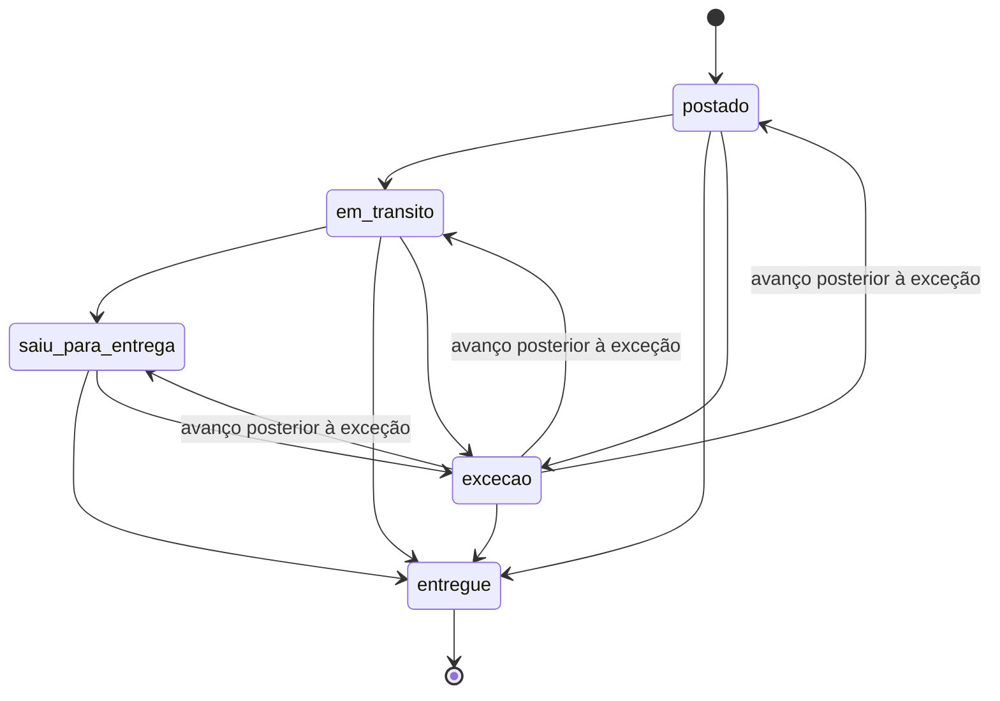

# Rastreio do produto enviado ao criador

API que acompanha o pacote que a marca manda para o criador. Ela cadastra o código de rastreio num agregador (fictício, no estilo de um serviço de rastreio), recebe os eventos por polling ou webhook, traduz o dialeto de cada transportadora para cinco status fixos e registra um alerta quando o pacote passa tempo demais em trânsito.

Os cinco status são `postado`, `em_transito`, `saiu_para_entrega`, `entregue` e `excecao`. Antes do primeiro evento o status é `null`.

Detalhes que não couberam aqui: [concorrência e teste de carga](docs/carga-e-concorrencia.md) e [exemplos reais com curl](docs/exemplos-api.md).

## Como rodar

Precisa de Node 22.13 ou mais novo. O teste de carga também precisa de Docker.

```bash
npm install
npm run dev          # API em :3105 e agregador fictício em :3115, no mesmo processo
npm test             # unitários e integração (sqlite em memória, relógio controlado)
npm run typecheck
npm run load         # sobe tudo com banco temporário, roda k6 no Docker e verifica as invariantes
```

| variável | padrão | para quê |
|---|---|---|
| `PORT` | `3105` | porta da API |
| `DB_PATH` | `rastreio.db` | arquivo sqlite |
| `DELAY_LIMIT_HOURS` | `168` | limite de tempo em trânsito antes do alerta (7 dias, valor que escolhi sem base em dado real) |
| `DELAY_LIMIT_HOURS_<TRANSPORTADORA>` | o global | limite só para aquela transportadora, ex. `DELAY_LIMIT_HOURS_CORREIOS=120` |
| `CONTENT_DUE_DAYS` | `7` | dias corridos, contados da entrega, para o prazo do conteúdo (`content_due_at`); valor que escolhi sem base em dado real |
| `FUTURE_TOLERANCE_MINUTES` | `10` | quanto um evento pode estar à frente do relógio antes de ser ignorado no cálculo |
| `AGGREGATOR_URL` | `http://localhost:3115` | onde está o agregador |
| `AGGREGATOR_WEBHOOK_SECRET` | `segredo-local` fora de produção | segredo do HMAC do webhook; obrigatório com `NODE_ENV=production` |
| `START_FAKE_AGGREGATOR` | `true` | sobe o agregador fictício junto com a API |
| `FAKE_AGGREGATOR_PORT` | `3115` | porta do agregador fictício |

## Rotas

| método e rota | o que faz |
|---|---|
| `POST /shipments` | cadastra `{ tracking_code, carrier }` no agregador. 201 na primeira vez, 200 com a mesma remessa depois. `carrier` precisa ser uma das transportadoras que o adaptador traduz (`correios`, `jadlog`, `loggi`) |
| `GET /shipments?limit=&offset=` | lista paginada (padrão 50, teto 200) com o resumo de cada remessa |
| `GET /shipments/:id` | remessa com status, histórico, mudanças de status e alertas |
| `POST /shipments/:id/refresh` | polling: busca o histórico no agregador e aplica o que for novo |
| `POST /webhooks/aggregator` | recebe o payload bruto do agregador, assinado com HMAC |
| `POST /jobs/check-delays` | job de atraso; pode rodar quantas vezes quiser |
| `GET /alerts?limit=&offset=&include_resolved=` | alertas abertos, paginados como acima; `include_resolved=true` traz também os resolvidos |

Erros seguem `{ "error": { "code", "message", "details"? } }`:

| status | quando |
|---|---|
| 400 | validação ou webhook malformado; `details` traz caminho e motivo de cada campo |
| 401 | assinatura do webhook ausente ou errada |
| 404 | rota, método, remessa ou referência desconhecida |
| 413 | corpo acima de 256 KB |
| 415 | `POST /shipments` sem `content-type: application/json` |
| 502 `agregador_indisponivel` | agregador fora do ar ou respondendo erro HTTP |
| 502 `agregador_resposta_invalida` | resposta inutilizável no cadastro ou no polling (HTML, formato errado, dados de outra remessa) |
| 500 | erro inesperado, com mensagem genérica; o detalhe vai só para o log |

Tudo que entra passa por schema zod. Os da API estão em `src/schemas.ts`, ligados com `@hono/zod-validator` e um hook único de erro. Os do formato do agregador e do header de assinatura estão em `src/aggregator/fake/schemas.ts`, dentro do adaptador. Campos extras são ignorados. Webhook com mais de 500 eventos, texto longo demais ou data sem fuso ou inexistente (30 de fevereiro) é recusado sem gravar nada. Os casos estão em `test/integration/payloads-invalidos.test.ts`.

## Como o código está dividido

```
src/
  domain/status.ts        status normalizado, NormalizedEvent e deriveState (regra pura)
  domain/delay.ts         isDelayed (regra pura)
  aggregator/types.ts     interface TrackingAggregator: supportedCarriers, register, getTracking, parseWebhook
  aggregator/fake/        cliente HTTP do agregador fictício, schemas do formato bruto, tradução e assinatura
  fake-aggregator/        o agregador fictício em si (app Hono em memória)
  schemas.ts              schemas zod da API (validation.ts tem as mensagens em português)
  service.ts              grava eventos, recalcula status, roda o job de atraso
  db.ts                   todo o acesso ao sqlite
  app.ts                  createApp(deps): rotas HTTP
  index.ts                só sobe os servidores
```

O domínio só conhece `NormalizedEvent`. O formato do agregador (`tracker`, `checkpoints`, `carrier_status`, o header de assinatura) fica em `src/aggregator/fake/` e no app fictício. Para trocar de agregador basta escrever outra classe que implemente `TrackingAggregator` e passar no `createApp`. `test/integration/swap-aggregator.test.ts` faz isso com um agregador de outro formato e outra autenticação, e `test/unit/boundary.test.ts` falha se os nomes do formato bruto aparecerem fora do adaptador.

## Do payload bruto ao status normalizado

Cada transportadora fala um dialeto. Correios manda texto livre, Jadlog manda códigos em caixa alta e Loggi manda códigos em inglês. O casamento é exato depois de normalizar (sem acento, sem diferenciar maiúsculas, espaços colapsados, sem ponto final). Com prefixo, "Objeto entregue ao destinatário errado" ou "Objeto saiu para entrega - cancelada" casariam com uma etapa que não aconteceu. A tabela fica em `src/aggregator/fake/mapping.ts`:

| transportadora | bruto | normalizado |
|---|---|---|
| correios | `Objeto postado` | `postado` |
| correios | `Objeto em trânsito - por favor aguarde` | `em_transito` |
| correios | `Objeto saiu para entrega ao destinatário` | `saiu_para_entrega` |
| correios | `Objeto entregue ao destinatário` | `entregue` |
| correios | `Objeto não entregue - destinatário ausente`, `Objeto devolvido ao remetente`, `Objeto entregue ao remetente` | `excecao` |
| jadlog | `EMISSAO`, `TRANSFERENCIA`, `EM ROTA`, `ENTREGUE` | `postado`, `em_transito`, `saiu_para_entrega`, `entregue` |
| loggi | `picked_up`, `in_transit`, `out_for_delivery`, `delivered`, `delivery_failed` | `postado`, `em_transito`, `saiu_para_entrega`, `entregue`, `excecao` |
| qualquer | texto fora da tabela, como `Objeto entregue ao destinatário errado` | `desconhecido` |

Payload bruto que o agregador fictício devolveu numa execução real (`GET /v1/trackers/trk_1`). Os checkpoints vêm na ordem em que foram registrados: o trânsito aparece antes da postagem, e o terceiro é um texto que a tabela não conhece.

```json
{
  "tracker": {
    "id": "trk_1",
    "tracking_number": "QB123456789BR",
    "carrier": "correios",
    "checkpoints": [
      {
        "checkpoint_id": "cp_1",
        "carrier_status": "Objeto em trânsito - por favor aguarde",
        "message": "de Unidade de Tratamento, Cajamar/SP para Unidade de Distribuição, Curitiba/PR",
        "location": "Cajamar/SP",
        "checkpoint_time": "2026-10-08T09:12:00-03:00"
      },
      {
        "checkpoint_id": "cp_2",
        "carrier_status": "Objeto postado",
        "message": null,
        "location": "São Paulo/SP",
        "checkpoint_time": "2026-10-06T16:40:00-03:00"
      },
      {
        "checkpoint_id": "cp_3",
        "carrier_status": "Objeto aguardando conferência na unidade",
        "message": null,
        "location": "Curitiba/PR",
        "checkpoint_time": "2026-10-09T07:30:00-03:00"
      }
    ]
  }
}
```

A mesma remessa depois de normalizada (`GET /shipments/:id`, com `DELAY_LIMIT_HOURS=72`, consultada em 2026-10-10 por volta de 04:17 UTC):

```json
{
  "id": "shp_9d725a1c-b419-47b4-9142-f2c068c2bcb4",
  "carrier": "correios",
  "tracking_code": "QB123456789BR",
  "aggregator_ref": "trk_1",
  "status": "em_transito",
  "status_since": "2026-10-08T12:12:00.000Z",
  "transit_started_at": "2026-10-06T19:40:00.000Z",
  "delivered_at": null,
  "delayed": true,
  "needs_review": true,
  "events": [
    { "status": "postado", "raw_code": "Objeto postado", "description": null, "location": "São Paulo/SP", "occurred_at": "2026-10-06T19:40:00.000Z", "ignored_reason": null },
    { "status": "em_transito", "raw_code": "Objeto em trânsito - por favor aguarde", "description": "de Unidade de Tratamento, Cajamar/SP para Unidade de Distribuição, Curitiba/PR", "location": "Cajamar/SP", "occurred_at": "2026-10-08T12:12:00.000Z", "ignored_reason": null },
    { "status": "desconhecido", "raw_code": "Objeto aguardando conferência na unidade", "description": null, "location": "Curitiba/PR", "occurred_at": "2026-10-09T10:30:00.000Z", "ignored_reason": null }
  ],
  "status_changes": [{ "from": null, "to": "em_transito", "at": "2026-10-10T04:17:52.184Z" }],
  "alerts": []
}
```

O histórico sai em ordem cronológica e em UTC. O texto desconhecido ficou registrado como veio, não mexeu no status e ligou `needs_review`.

## Regras e decisões

### Status derivado do conjunto de eventos

A cada evento novo, `deriveState` (`src/domain/status.ts`) recalcula o status a partir de todos os eventos da remessa. O resultado é o mesmo em qualquer ordem de chegada, e um teste unitário confere isso com todas as permutações de um histórico.

1. Eventos de progresso têm rank: `postado` 1, `em_transito` 2, `saiu_para_entrega` 3, `entregue` 4. O status é o maior rank já visto, então um evento antigo que chega depois não faz o status regredir.
2. Uma leitura mais nova de etapa menor (o pacote saiu para entrega e depois aparece "em trânsito") também não rebaixa o status. Essa é uma decisão consciente: para quem acompanha a campanha, importa a etapa mais avançada já alcançada, e um status que vai e volta a cada leitura interna da transportadora só gera ruído. Quando algo dá errado de fato, a transportadora manda uma exceção, e esse é o único caminho que tira o status da etapa alcançada.
3. `entregue` é terminal. Uma exceção posterior fica no histórico, mas o status continua `entregue`.
4. `excecao` vale enquanto nenhum evento de progresso tiver horário estritamente posterior à exceção mais recente. Um avanço posterior resolve a exceção, e o status volta ao maior rank já alcançado. Exceção antiga chegando atrasada não derruba um avanço mais novo. No empate de horário a exceção prevalece, por ser o lado mais conservador.
5. Eventos `desconhecido` e eventos com `ignored_reason` ficam fora do cálculo e ligam `needs_review`.



Pular etapas é permitido porque transportadoras às vezes não reportam todas.

### Status que a transportadora inventou

Texto ou código fora da tabela vira `desconhecido`. Ele fica no histórico com o texto original e liga `needs_review: true`, mas não muda o status nem inicia o relógio de trânsito.

Pensei em tratar desconhecido como `excecao` e desisti: transportadora muda texto o tempo todo, e cada variação nova pareceria problema no pacote. Também não tento adivinhar. "Objeto entregue ao destinatário errado" e o código Jadlog `ENTREGUE PARCIAL` contêm a palavra "entregue" e viram `desconhecido`. Errar para `entregue` seria o pior caso, porque o prazo de conteúdo do criador começaria a contar sem o produto na mão dele. O custo é que alguém precisa olhar as remessas com `needs_review` e acrescentar o texto na tabela.

A tradução é refeita a cada recálculo a partir do `raw_code` guardado, com a tabela atual. Quando a tabela ganha um texto, o próximo polling ou webhook da remessa (mesmo sem evento novo) passa a contar aqueles eventos e desliga `needs_review` se não sobrar nada pendente. O histórico não perde nada: muda só a coluna `status` do evento, e o texto original fica.

### Evento com data no futuro

Um evento datado mais de 10 minutos (configurável) depois do instante em que chegou entra no histórico com `ignored_reason: "data_no_futuro"`, fica fora do status e do relógio de trânsito e liga `needs_review`. Preferi guardar a recusar porque o evento pode ser verdadeiro com fuso trocado, e alguém precisa ver isso. A decisão é tomada na chegada e fica gravada. Se o mesmo evento for reenviado depois, ele cai no dedupe e continua ignorado.

### Deduplicação

O agregador fictício manda `checkpoint_id`, e esse é o id do evento. Sem ele (ou com id vazio), a chave é um hash de horário em UTC, código bruto e local. A tabela `tracking_events` tem `UNIQUE (shipment_id, event_key)` e o insert usa `ON CONFLICT DO NOTHING`. Consultar de novo, receber o mesmo webhook várias vezes ou receber o mesmo evento por polling e por webhook grava o evento uma vez só.

Se o agregador corrigir um evento mantendo o mesmo `checkpoint_id`, a correção é ignorada e vale a primeira versão. Não sei como um agregador real sinalizaria correções, e sobrescrever em silêncio deixaria o histórico mudar depois de usado.

Polling e webhook também conferem se a referência, a transportadora e o código de rastreio devolvidos são os da remessa. A tradução depende do dialeto da transportadora, e um evento de outra remessa não pode entrar nesta.

### Atraso

`isDelayed` (`src/domain/delay.ts`) considera atraso quando o pacote não está `entregue`, o relógio de trânsito já começou (o início é o evento conhecido mais antigo, normalmente o `postado`) e `agora - início` passa estritamente do limite.

O "agora" vem do `Clock` injetado, então os testes controlam a data. No limite exato ainda não é atraso, e um milissegundo depois já é. Entrega normal não vira atraso porque `entregue` sai da conta, por mais tempo que passe depois. Uma `excecao` em aberto continua contando, já que o pacote ainda não chegou.

`POST /jobs/check-delays` percorre as remessas em trânsito. Antes de criar um alerta novo, ele reconsulta o agregador para aquela remessa, porque o webhook da entrega pode ter se perdido. Se a reconsulta mostrar a entrega, não há alerta. Se ela falhar, o alerta é criado com `stale: true` (a informação pode estar desatualizada). Remessa que já tem alerta não é reconsultada. Os alertas ficam em `alerts`, que tem `UNIQUE (shipment_id, kind)`. Rodar de novo, ou em paralelo, não duplica o alerta. A remessa entregue devolve `content_due_at`, o prazo do conteúdo do criador contado a partir da entrega (`CONTENT_DUE_DAYS`, padrão 7 dias). Antes da entrega o campo é `null`, porque o prazo só faz sentido com o produto na mão.

Quando a remessa é entregue depois do alerta, ele ganha `resolved_at` e sai da lista padrão de `GET /alerts`, mas continua registrado. A tabela serve como outbox para quem for mandar e-mail ou mensagem. Esse envio não está implementado.

### Autenticação do webhook

O agregador assina o corpo bruto com HMAC-SHA256 e manda `x-aggregator-signature: sha256=<hex>`. O cliente valida o formato do header, compara com `crypto.timingSafeEqual` e só então faz o parse do JSON e passa o schema. Sem header ou com assinatura que não confere, a resposta é 401 e nada é gravado. A verificação fica no adaptador porque nome do header e esquema de assinatura variam de agregador para agregador.

### Onde cada critério é testado

| critério | teste |
|---|---|
| status desconhecido não vira entregue | `test/unit/mapping.test.ts` ("status inventado ... vira desconhecido, nunca entregue"), `test/integration/shipments.test.ts` ("status desconhecido não vira entregue: ...", "devolução ao remetente") |
| evento fora de ordem não regride | `test/unit/status.test.ts` ("o resultado é o mesmo em qualquer ordem de chegada"), `test/integration/shipments.test.ts` ("evento antigo que chega depois ...", "leitura mais nova de etapa menor não rebaixa o status") |
| consultar de novo não duplica | `test/integration/shipments.test.ts` ("consultar de novo o mesmo código não duplica o histórico", "polls concorrentes ...") |
| atraso com data controlada | `test/unit/delay.test.ts`, `test/integration/delays.test.ts` (limite exato, 1 ms antes e depois, entrega normal, job repetido) |
| agregador trocável | `test/integration/swap-aggregator.test.ts`, `test/unit/boundary.test.ts` |
| concorrência | `test/integration/concurrency.test.ts` |
| assinatura, payloads inválidos, resposta ruim do agregador, datas no futuro | `webhook-signature`, `payloads-invalidos`, `aggregator-response` e `future-events`, em `test/integration/` |

## Por que essa solução

Para o volume esperado aqui (remessas por campanha, poucos eventos por pacote, webhooks repetidos), um processo Node com sqlite dá conta. As escritas são serializadas, as restrições UNIQUE fazem a deduplicação e cada aplicação de eventos roda em `BEGIN IMMEDIATE`. Não usei Redis nem lock distribuído porque não há efeito colateral externo dentro da transação; o alerta é só uma linha no banco.

Recalcular o status do histórico inteiro custa uma leitura de poucas linhas por evento novo e elimina a classe de bug "evento antigo sobrescreveu o novo". O caminho com várias instâncias (Postgres, `SELECT ... FOR UPDATE` por remessa, outbox) está em [docs/carga-e-concorrencia.md](docs/carga-e-concorrencia.md).

## Teste de carga

`npm run load` cadastra 40 remessas em 4 cenários e roda o k6 por 30 s com até 50 VUs, misturando webhooks repetidos e fora de ordem, polling, job de atraso, webhooks forjados e payloads inválidos. No fim, um script confere as invariantes. Última execução real, nesta máquina (2026-10-10):

```
   ✓ checks.........................: 100.00% 129945 out of 129945
   ✓ http_req_duration..............: avg=9.63ms  min=92.46µs  med=6.32ms max=64.23ms p(90)=23.63ms p(95)=27.01ms
   ✓ http_req_failed................: 0.00%   0 out of 129986
     http_reqs......................: 129986  4327.309506/s
verificação ok: 40 remessas, 140 eventos únicos, 20 alertas, nenhum status regrediu
```

Cenário, frações de cada ação, thresholds e a variação entre rodadas estão em [docs/carga-e-concorrencia.md](docs/carga-e-concorrencia.md).

## O que ficou de fora

- Envio do aviso de atraso (e-mail, Slack). O alerta fica gravado em `alerts`.
- Alerta para remessa cadastrada que nunca foi postada. Sem evento, o relógio de trânsito não começa.
- Limite de atraso por transportadora ou por campanha. Hoje é um valor global.
- Polling periódico automático e retentativa com backoff. O polling é disparado por `POST /shipments/:id/refresh`.
- Fila de revisão para `needs_review`, com rota para listar esses casos e acrescentar texto na tabela sem deploy.
- Rotação do segredo do webhook e proteção contra replay (timestamp assinado).
- Autenticação da própria API.
- Correção de evento já recebido (mesmo `checkpoint_id` com dados diferentes): vale a primeira versão, sem aviso.
- A mesma ocorrência reemitida pelo agregador com outro `checkpoint_id` duplica o histórico, porque o id é a identidade do evento quando existe. O status não muda (o cálculo usa o conjunto), mas a linha aparece duas vezes.

## O que eu faria diferente com mais tempo

Colocaria a tabela de tradução no banco, com uma tela simples para quem revisa `needs_review` cadastrar o texto novo e reprocessar as remessas afetadas. Também guardaria o payload bruto de cada webhook por alguns dias, para investigar quando uma transportadora muda o formato.

## Uso de IA

O código, os testes e este README foram produzidos com Claude Code (Claude Opus) a partir do enunciado do desafio. A assinatura HMAC do webhook entrou numa revisão de segurança.

O que eu revisei: revisei as regras de status, desconhecido e atraso e os testes que cobrem cada critério, rodei `npm test`, `npm run typecheck` e `npm run load` localmente e conferi os exemplos de curl contra a API rodando.
