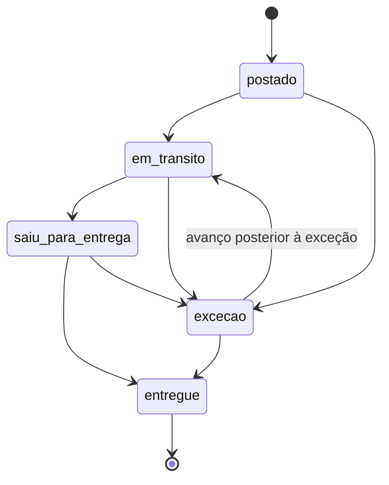

# Rastreio do produto enviado ao criador

API que acompanha o pacote que a marca manda para o criador. Ela cadastra o código de rastreio num agregador (fictício, no estilo de um serviço de rastreio), recebe os eventos por polling ou webhook, traduz o dialeto de cada transportadora para cinco status fixos e registra um alerta quando o pacote passa tempo demais em trânsito.

Os cinco status são `postado`, `em_transito`, `saiu_para_entrega`, `entregue` e `excecao`. Antes do primeiro evento o status é `null`.

Mais detalhes em [regras e decisões](docs/decisoes.md), [concorrência e teste de carga](docs/carga-e-concorrencia.md) e [exemplos reais com curl](docs/exemplos-api.md).

## Como rodar

Precisa de Node 22.13 ou mais novo. O teste de carga também precisa de Docker.

```bash
npm install
npm run dev          # API em :3105 e agregador fictício em :3115, no mesmo processo
npm test             # unitários e integração (sqlite em memória, relógio controlado)
npm run typecheck
npm run load         # sobe tudo com banco temporário, roda k6 no Docker e verifica as invariantes
```

| variável | padrão | para quê |
|---|---|---|
| `PORT`, `DB_PATH` | `3105`, `rastreio.db` | porta da API e arquivo sqlite |
| `DELAY_LIMIT_HOURS` | `168` | limite de tempo em trânsito antes do alerta (7 dias, escolhido sem base em dado real) |
| `DELAY_LIMIT_HOURS_<TRANSPORTADORA>` | o global | limite só para aquela transportadora, ex. `DELAY_LIMIT_HOURS_CORREIOS=120` |
| `CONTENT_DUE_DAYS` | `7` | dias, contados da entrega, para o prazo do conteúdo (`content_due_at`) |
| `FUTURE_TOLERANCE_MINUTES` | `10` | quanto um evento pode estar à frente do relógio antes de ser ignorado no cálculo |
| `AGGREGATOR_URL`, `AGGREGATOR_WEBHOOK_SECRET` | `http://localhost:3115`, `segredo-local` | agregador e segredo do HMAC; o segredo é obrigatório com `NODE_ENV=production` |
| `START_FAKE_AGGREGATOR`, `FAKE_AGGREGATOR_PORT` | `true`, `3115` | sobe o agregador fictício junto com a API |

## Rotas

| método e rota | o que faz |
|---|---|
| `POST /shipments` | cadastra `{ tracking_code, carrier }` no agregador. 201 na primeira vez, 200 com a mesma remessa depois. `carrier` precisa ser `correios`, `jadlog` ou `loggi` |
| `GET /shipments?limit=&offset=` | lista paginada (padrão 50, teto 200) com o resumo de cada remessa |
| `GET /shipments/:id` | remessa com status, histórico, mudanças de status, alertas e `content_due_at` |
| `POST /shipments/:id/refresh` | polling: busca o histórico no agregador e aplica o que for novo |
| `POST /webhooks/aggregator` | recebe o payload bruto do agregador, assinado com HMAC |
| `POST /jobs/check-delays` | job de atraso; pode rodar quantas vezes quiser |
| `GET /alerts?include_resolved=` | alertas abertos, paginados; `include_resolved=true` traz também os resolvidos |

Erros seguem `{ "error": { "code", "message", "details"? } }` com 400, 401, 404, 413, 415, 502 ou 500. Tudo que entra passa por schema zod; a tabela completa de status e a validação estão em [docs/decisoes.md](docs/decisoes.md#erros-e-validação).

## Como o código está dividido

```
src/
  domain/                 status.ts (deriveState) e delay.ts (isDelayed, contentDueAt): regra pura
  aggregator/types.ts     interface TrackingAggregator
  aggregator/fake/        cliente HTTP do agregador fictício, schemas do formato bruto, tradução e assinatura
  fake-aggregator/        o agregador fictício em si (app Hono em memória)
  schemas.ts              schemas zod da API
  service.ts              grava eventos, recalcula status, roda o job de atraso
  db.ts, app.ts, index.ts acesso ao sqlite, rotas HTTP (createApp) e subida dos servidores
```

O domínio só conhece `NormalizedEvent`. O formato do agregador (`tracker`, `checkpoints`, `carrier_status`, o header de assinatura) fica em `src/aggregator/fake/`. Para trocar de agregador basta escrever outra classe que implemente `TrackingAggregator` (transportadoras suportadas, cadastro, consulta, webhook e tradução de código) e passar no `createApp`. `test/integration/swap-aggregator.test.ts` faz isso com um agregador de outro formato, e `test/unit/boundary.test.ts` falha se o formato bruto aparecer fora do adaptador.

## Do payload bruto ao status normalizado

Correios manda texto livre, Jadlog manda códigos em caixa alta e Loggi manda códigos em inglês. O casamento é exato depois de normalizar acento, maiúsculas e espaços. A tabela fica em `src/aggregator/fake/mapping.ts`:

| transportadora | bruto | normalizado |
|---|---|---|
| correios | `Objeto postado`, `Objeto em trânsito - por favor aguarde`, `Objeto saiu para entrega ao destinatário`, `Objeto entregue ao destinatário` | `postado`, `em_transito`, `saiu_para_entrega`, `entregue` |
| correios | `Objeto não entregue - destinatário ausente`, `Objeto devolvido ao remetente`, `Objeto entregue ao remetente` | `excecao` |
| jadlog | `EMISSAO`, `TRANSFERENCIA`, `EM ROTA`, `ENTREGUE` | `postado`, `em_transito`, `saiu_para_entrega`, `entregue` |
| loggi | `picked_up`, `in_transit`, `out_for_delivery`, `delivered`, `delivery_failed` | `postado`, `em_transito`, `saiu_para_entrega`, `entregue`, `excecao` |
| qualquer | texto fora da tabela, como `Objeto entregue ao destinatário errado` | `desconhecido` |

Payload bruto que o agregador fictício devolveu numa execução real (`GET /v1/trackers/trk_1`). Os checkpoints vêm na ordem em que foram registrados: o trânsito aparece antes da postagem, e o terceiro é um texto que a tabela não conhece.

```json
{
  "tracker": {
    "id": "trk_1",
    "tracking_number": "QB123456789BR",
    "carrier": "correios",
    "checkpoints": [
      { "checkpoint_id": "cp_1", "carrier_status": "Objeto em trânsito - por favor aguarde", "message": "de Unidade de Tratamento, Cajamar/SP para Unidade de Distribuição, Curitiba/PR", "location": "Cajamar/SP", "checkpoint_time": "2026-10-08T09:12:00-03:00" },
      { "checkpoint_id": "cp_2", "carrier_status": "Objeto postado", "message": null, "location": "São Paulo/SP", "checkpoint_time": "2026-10-06T16:40:00-03:00" },
      { "checkpoint_id": "cp_3", "carrier_status": "Objeto aguardando conferência na unidade", "message": null, "location": "Curitiba/PR", "checkpoint_time": "2026-10-09T07:30:00-03:00" }
    ]
  }
}
```

A mesma remessa depois de normalizada (`GET /shipments/:id`, com `DELAY_LIMIT_HOURS=72`, consultada em 2026-10-10 por volta de 13:01 UTC):

```json
{
  "id": "shp_9d9af6dd-f587-4bd0-bd3f-96d5d67b4d12",
  "carrier": "correios",
  "tracking_code": "QB123456789BR",
  "aggregator_ref": "trk_1",
  "status": "em_transito",
  "status_since": "2026-10-08T12:12:00.000Z",
  "transit_started_at": "2026-10-06T19:40:00.000Z",
  "delivered_at": null,
  "content_due_at": null,
  "delayed": true,
  "needs_review": true,
  "events": [
    { "status": "postado", "raw_code": "Objeto postado", "description": null, "location": "São Paulo/SP", "occurred_at": "2026-10-06T19:40:00.000Z", "ignored_reason": null },
    { "status": "em_transito", "raw_code": "Objeto em trânsito - por favor aguarde", "description": "de Unidade de Tratamento, Cajamar/SP para Unidade de Distribuição, Curitiba/PR", "location": "Cajamar/SP", "occurred_at": "2026-10-08T12:12:00.000Z", "ignored_reason": null },
    { "status": "desconhecido", "raw_code": "Objeto aguardando conferência na unidade", "description": null, "location": "Curitiba/PR", "occurred_at": "2026-10-09T10:30:00.000Z", "ignored_reason": null }
  ],
  "status_changes": [{ "from": null, "to": "em_transito", "at": "2026-10-10T13:01:55.262Z" }],
  "alerts": []
}
```

O histórico sai em ordem cronológica e em UTC. O texto desconhecido ficou registrado como veio, não mexeu no status e ligou `needs_review`.

## Regras

O porquê de cada uma está em [docs/decisoes.md](docs/decisoes.md).

- O status é recalculado do conjunto inteiro de eventos a cada polling ou webhook, então a ordem de chegada não importa. Vale a etapa mais avançada já alcançada, e um evento antigo que chega depois não faz o status regredir.
- Uma leitura mais nova de etapa menor também não rebaixa o status. É uma decisão consciente: para a campanha importa a etapa mais avançada, e só uma exceção tira o status dela. `entregue` é terminal. Um avanço posterior à exceção a resolve.
- Status que a transportadora inventou vira `desconhecido`: fica no histórico, não muda o status e liga `needs_review`. A tradução é refeita do `raw_code` guardado a cada recálculo, então o evento passa a valer quando a tabela ganha o texto.
- Evento datado mais de 10 minutos no futuro fica no histórico com `ignored_reason: "data_no_futuro"`, fora do cálculo.
- Cada evento é gravado uma vez por remessa (`UNIQUE (shipment_id, event_key)`). A chave é o `checkpoint_id` ou, sem ele, um hash de horário, código e local.
- Atraso é tempo desde o primeiro evento conhecido, sem `entregue`, estritamente acima do limite, medido pelo `Clock` injetado. Entregue nunca é atraso.
- O job reconsulta o agregador antes de criar um alerta, cria no máximo um por remessa, marca `stale: true` se a reconsulta falhar e grava `resolved_at` quando o pacote é entregue depois.
- O webhook só é aceito com HMAC-SHA256 válido do corpo bruto.



O diagrama mostra o caminho principal. Pular etapas é permitido, e depois de uma exceção o status volta ao maior rank já alcançado.

### Onde cada critério é testado

| critério | teste |
|---|---|
| status desconhecido não vira entregue | `test/unit/mapping.test.ts` ("status inventado ... nunca entregue"), `test/integration/shipments.test.ts` ("status desconhecido não vira entregue: ...") |
| evento fora de ordem não regride | `test/unit/status.test.ts` ("o resultado é o mesmo em qualquer ordem de chegada"), `test/integration/shipments.test.ts` ("evento antigo que chega depois ...", "leitura mais nova de etapa menor não rebaixa o status") |
| consultar de novo não duplica | `test/integration/shipments.test.ts` ("consultar de novo o mesmo código não duplica o histórico", "polls concorrentes ...") |
| atraso com data controlada | `test/unit/delay.test.ts`, `test/integration/delays.test.ts` (limite exato, 1 ms antes e depois, entrega normal, reconsulta, fechamento, limite por transportadora) |
| agregador trocável | `test/integration/swap-aggregator.test.ts`, `test/unit/boundary.test.ts` |
| concorrência | `test/integration/concurrency.test.ts` |
| robustez | `webhook-signature`, `payloads-invalidos`, `prototype-keys`, `aggregator-response`, `future-events` e `retranslate`, em `test/integration/` |

## Por que essa solução

Para o volume esperado aqui (remessas por campanha, poucos eventos por pacote, webhooks repetidos), um processo Node com sqlite dá conta. As escritas são serializadas, as restrições UNIQUE fazem a deduplicação e cada aplicação de eventos roda em `BEGIN IMMEDIATE`. Não usei Redis nem lock distribuído porque não há efeito colateral externo dentro da transação; o alerta é só uma linha no banco. Recalcular o status do histórico inteiro custa uma leitura de poucas linhas e elimina a classe de bug "evento antigo sobrescreveu o novo". O caminho com várias instâncias está em [docs/carga-e-concorrencia.md](docs/carga-e-concorrencia.md).

## Teste de carga

`npm run load` cadastra 40 remessas em 4 cenários e roda o k6 por 30 s com até 50 VUs, misturando webhooks repetidos e fora de ordem, polling, job de atraso, webhooks forjados e payloads inválidos. No fim, um script confere as invariantes. Última execução real, nesta máquina (2026-10-10):

```
   ✓ checks.........................: 100.00% 99894 out of 99894
   ✓ http_req_duration..............: avg=12.52ms min=103.83µs med=6.99ms  max=378.12ms p(90)=26.4ms  p(95)=35.37ms
   ✓ http_req_failed................: 0.00%   0 out of 99935
     http_reqs......................: 99935   3329.336415/s
verificação ok: 40 remessas, 140 eventos únicos, 20 alertas, nenhum status regrediu
```

## O que ficou de fora

- Envio do aviso de atraso (e-mail, Slack). O alerta fica em `alerts`, que serve de outbox.
- Alerta para remessa cadastrada que nunca foi postada. Sem evento, o relógio de trânsito não começa.
- Limite de atraso por campanha (por transportadora já existe).
- Polling periódico automático e retentativa com backoff. O polling é disparado por `POST /shipments/:id/refresh` e pelo job de atraso.
- Fila de revisão para `needs_review` e tabela de tradução editável sem deploy.
- Rotação do segredo do webhook, proteção contra replay e autenticação da própria API.
- Correção de evento já recebido (mesmo `checkpoint_id` com dados diferentes): vale a primeira versão, sem aviso.
- A mesma ocorrência reemitida pelo agregador com outro `checkpoint_id` duplica o histórico. O status não muda (o cálculo usa o conjunto), mas a linha aparece duas vezes.

## O que eu faria diferente com mais tempo

Colocaria a tabela de tradução no banco, com uma tela simples para quem revisa `needs_review` cadastrar o texto novo. A retradução no recálculo já existe, então as remessas afetadas passariam a valer no próximo polling ou webhook. Também guardaria o payload bruto de cada webhook por alguns dias, para investigar quando uma transportadora muda o formato.

## Uso de IA

O código, os testes e este README foram produzidos com Claude Code (Claude Opus) a partir do enunciado do desafio. A assinatura HMAC do webhook entrou numa revisão de segurança.

O que eu revisei: revisei as regras de status, desconhecido e atraso e os testes que cobrem cada critério, rodei `npm test`, `npm run typecheck` e `npm run load` localmente e conferi os exemplos de curl contra a API rodando.
