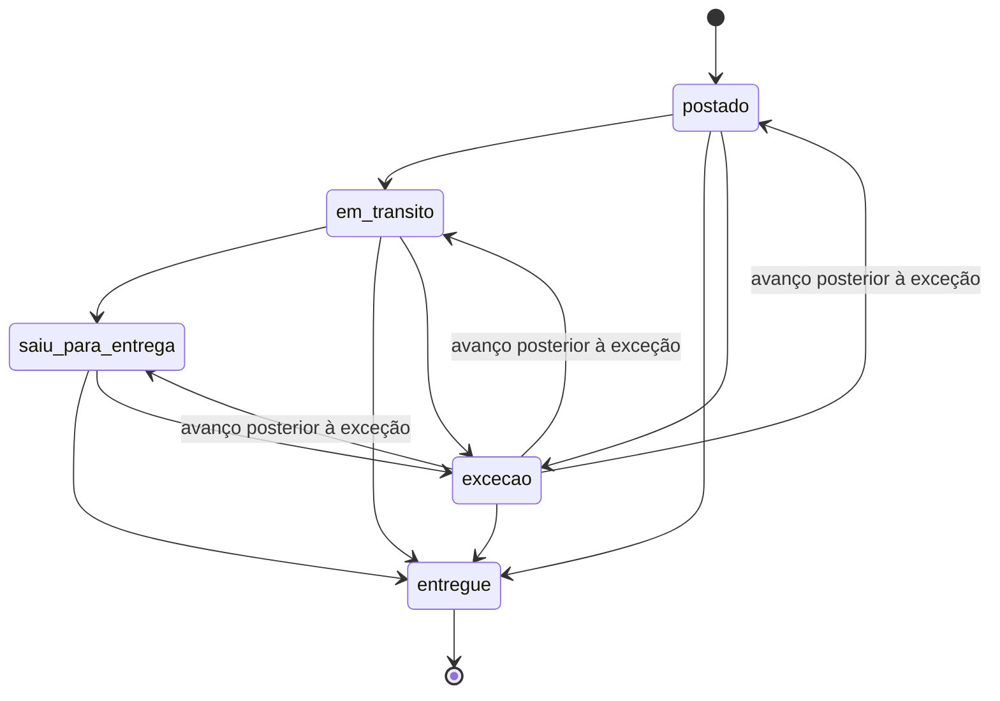

# Rastreio do produto enviado ao criador

API que acompanha o pacote que a marca manda para o criador. Ela cadastra o código de rastreio num agregador (fictício, no estilo de um serviço de rastreio), recebe os eventos por polling ou webhook, traduz o dialeto de cada transportadora para cinco status fixos e registra um alerta quando o pacote passa tempo demais em trânsito.

Os cinco status: `postado`, `em_transito`, `saiu_para_entrega`, `entregue` e `excecao`. Antes do primeiro evento o status é `null`.

## Como rodar

Precisa de Node 22 ou mais novo. O teste de carga também precisa de Docker.

```bash
npm install
npm run dev          # API em :3105 e agregador fictício em :3115, no mesmo processo
npm test             # unitários e integração (sqlite em memória, relógio controlado)
npm run typecheck
npm run load         # sobe tudo com banco temporário, roda k6 no Docker e verifica as invariantes
```

Variáveis de ambiente:

| variável | padrão | para quê |
|---|---|---|
| `PORT` | `3105` | porta da API |
| `DB_PATH` | `rastreio.db` | arquivo sqlite |
| `DELAY_LIMIT_HOURS` | `168` | limite de tempo em trânsito antes do alerta (7 dias, valor que escolhi sem base em dado real) |
| `AGGREGATOR_URL` | `http://localhost:3115` | onde está o agregador |
| `AGGREGATOR_WEBHOOK_SECRET` | `segredo-local` fora de produção | segredo do HMAC do webhook; com `NODE_ENV=production` é obrigatório |
| `START_FAKE_AGGREGATOR` | `true` | sobe o agregador fictício junto com a API |
| `FAKE_AGGREGATOR_PORT` | `3115` | porta do agregador fictício |

## Rotas

| método e rota | o que faz |
|---|---|
| `POST /shipments` | cadastra `{ tracking_code, carrier }` no agregador. 201 na primeira vez, 200 com a mesma remessa nas seguintes |
| `GET /shipments`, `GET /shipments/:id` | remessa com status, histórico, mudanças de status e alertas |
| `POST /shipments/:id/refresh` | polling: busca o histórico no agregador e aplica o que for novo |
| `POST /webhooks/aggregator` | recebe o payload bruto do agregador, assinado com HMAC |
| `POST /jobs/check-delays` | job de atraso; pode rodar quantas vezes quiser |
| `GET /alerts` | alertas registrados |

Erros seguem `{ "error": { "code", "message" } }`: 400 para validação ou payload inválido, 401 para assinatura ausente ou errada, 404 para remessa ou referência desconhecida, 502 quando o agregador não responde.

## Como o código está dividido

```
src/
  domain/status.ts        status normalizado, NormalizedEvent e deriveState (regra pura)
  domain/delay.ts         isDelayed (regra pura)
  aggregator/types.ts     interface TrackingAggregator: register, getTracking, parseWebhook
  aggregator/fake/        cliente HTTP do agregador fictício, tradução dos dialetos e assinatura
  fake-aggregator/        o agregador fictício em si (app Hono em memória)
  service.ts              orquestra: grava eventos, recalcula status, roda o job de atraso
  db.ts                   todo o acesso ao sqlite
  app.ts                  createApp(deps): rotas HTTP
  index.ts                só sobe os servidores
```

O domínio só conhece `NormalizedEvent`. O formato do agregador (`tracker`, `checkpoints`, `carrier_status`, o header de assinatura) fica em `src/aggregator/fake/` e no app fictício. Para trocar de agregador basta escrever outra classe que implemente `TrackingAggregator` e passar no `createApp`. Dois testes cobrem isso: `test/integration/swap-aggregator.test.ts` usa um agregador com outro formato e outro esquema de autenticação sem mudar nada fora do teste, e `test/unit/boundary.test.ts` falha se os nomes do formato bruto aparecerem fora do adaptador.

## Do payload bruto ao status normalizado

As transportadoras falam dialetos diferentes. Correios manda texto livre, às vezes com complemento (o casamento é por prefixo, sem acento e sem diferenciar maiúsculas). Jadlog manda códigos em caixa alta e Loggi manda códigos em inglês. A tabela fica em `src/aggregator/fake/mapping.ts`:

| transportadora | bruto | normalizado |
|---|---|---|
| correios | `Objeto postado` | `postado` |
| correios | `Objeto em trânsito - por favor aguarde` | `em_transito` |
| correios | `Objeto saiu para entrega ao destinatário` | `saiu_para_entrega` |
| correios | `Objeto entregue ao destinatário` | `entregue` |
| correios | `Objeto não entregue - destinatário ausente` | `excecao` |
| jadlog | `EMISSAO`, `TRANSFERENCIA`, `EM ROTA`, `ENTREGUE` | `postado`, `em_transito`, `saiu_para_entrega`, `entregue` |
| loggi | `picked_up`, `in_transit`, `out_for_delivery`, `delivered`, `delivery_failed` | `postado`, `em_transito`, `saiu_para_entrega`, `entregue`, `excecao` |
| qualquer | código fora da tabela | `desconhecido` |

Payload bruto que o agregador fictício devolveu numa execução real (`GET /v1/trackers/trk_1`). Os checkpoints vêm na ordem em que foram registrados: o trânsito aparece antes da postagem, e o terceiro é um status que a tabela não conhece.

```json
{
  "tracker": {
    "id": "trk_1",
    "tracking_number": "QB123456789BR",
    "carrier": "correios",
    "checkpoints": [
      {
        "checkpoint_id": "cp_1",
        "carrier_status": "Objeto em trânsito - por favor aguarde",
        "message": "de Unidade de Tratamento, Cajamar/SP para Unidade de Distribuição, Curitiba/PR",
        "location": "Cajamar/SP",
        "checkpoint_time": "2026-10-08T09:12:00-03:00"
      },
      {
        "checkpoint_id": "cp_2",
        "carrier_status": "Objeto postado",
        "message": null,
        "location": "São Paulo/SP",
        "checkpoint_time": "2026-10-06T16:40:00-03:00"
      },
      {
        "checkpoint_id": "cp_3",
        "carrier_status": "Objeto aguardando conferência na unidade",
        "message": null,
        "location": "Curitiba/PR",
        "checkpoint_time": "2026-10-09T07:30:00-03:00"
      }
    ]
  }
}
```

A mesma remessa depois de normalizada (`GET /shipments/:id`, com `DELAY_LIMIT_HOURS=72`, consultada em 2026-10-10 por volta de 03:30 UTC):

```json
{
  "id": "shp_476c2cae-7cdb-47d1-82e7-eb70f304a7e9",
  "carrier": "correios",
  "tracking_code": "QB123456789BR",
  "aggregator_ref": "trk_1",
  "status": "em_transito",
  "status_since": "2026-10-08T12:12:00.000Z",
  "transit_started_at": "2026-10-06T19:40:00.000Z",
  "delivered_at": null,
  "delayed": true,
  "needs_review": true,
  "events": [
    { "status": "postado", "raw_code": "Objeto postado", "description": null, "location": "São Paulo/SP", "occurred_at": "2026-10-06T19:40:00.000Z" },
    { "status": "em_transito", "raw_code": "Objeto em trânsito - por favor aguarde", "description": "de Unidade de Tratamento, Cajamar/SP para Unidade de Distribuição, Curitiba/PR", "location": "Cajamar/SP", "occurred_at": "2026-10-08T12:12:00.000Z" },
    { "status": "desconhecido", "raw_code": "Objeto aguardando conferência na unidade", "description": null, "location": "Curitiba/PR", "occurred_at": "2026-10-09T10:30:00.000Z" }
  ],
  "status_changes": [{ "from": null, "to": "em_transito", "at": "2026-10-10T03:30:20.346Z" }],
  "alerts": []
}
```

O histórico sai em ordem cronológica e com horário em UTC. O status desconhecido ficou registrado com o texto original, não mexeu no status e ligou `needs_review`.

## Regras e decisões

### Status derivado do conjunto de eventos

A cada evento novo, `deriveState` (`src/domain/status.ts`) recalcula o status a partir de todos os eventos da remessa, e o resultado é o mesmo em qualquer ordem de chegada. Um teste unitário confere isso com todas as permutações de um histórico. As regras:

1. Eventos de progresso têm rank: `postado` 1, `em_transito` 2, `saiu_para_entrega` 3, `entregue` 4. O status é o maior rank já visto. Um evento antigo que chega depois não diminui esse máximo, então o status não regride.
2. `entregue` é terminal. Uma exceção posterior fica no histórico, mas o status continua `entregue`.
3. `excecao` vale enquanto nenhum evento de progresso tiver horário estritamente posterior à exceção mais recente. Um avanço posterior resolve a exceção, e o status volta ao maior rank já alcançado (se o pacote já tinha saído para entrega e volta para o centro de distribuição depois de uma tentativa falha, o status fica `saiu_para_entrega`). Exceção antiga chegando atrasada não derruba um avanço mais novo. No empate de horário a exceção prevalece, por ser o lado mais conservador.
4. Eventos `desconhecido` são ignorados no cálculo.



Pular etapas é permitido porque transportadoras às vezes não reportam todas.

### Status que a transportadora inventou

Qualquer código fora da tabela vira `desconhecido`. Ele fica no histórico com o texto original e marca `needs_review: true`, mas não muda o status nem inicia o relógio de trânsito.

Pensei em tratar desconhecido como `excecao`. Desisti porque transportadora muda texto o tempo todo, e cada variação nova iria parecer problema no pacote e poderia esconder um avanço real. Também não tento adivinhar: "Entregue ao vizinho, talvez" e o código Jadlog `ENTREGUE PARCIAL` contêm a palavra "entregue" e mesmo assim viram `desconhecido`. Errar para `entregue` seria o pior caso, porque o prazo de conteúdo do criador começaria a contar sem o produto na mão dele. O custo dessa escolha é que alguém precisa olhar as remessas com `needs_review` e acrescentar o código na tabela.

### Deduplicação

Cada evento tem uma chave. O agregador fictício manda `checkpoint_id` e eu uso esse valor. Sem ele, a chave é um hash de horário (normalizado para UTC), código bruto e local. A tabela `tracking_events` tem `UNIQUE (shipment_id, event_key)` e o insert usa `ON CONFLICT DO NOTHING`. Consultar de novo, receber o mesmo webhook várias vezes ou receber o mesmo evento por polling e por webhook grava o evento uma vez só.

### Atraso

`isDelayed` (`src/domain/delay.ts`) considera atraso quando:

- o pacote não está `entregue`,
- o relógio de trânsito começou (há pelo menos um evento conhecido; o início é o horário do evento conhecido mais antigo, normalmente o `postado`),
- e `agora - início` é estritamente maior que o limite.

O "agora" vem do `Clock` injetado, então os testes controlam a data. No limite exato ainda não é atraso, e um milissegundo depois já é. Entrega normal não vira atraso porque `entregue` sai da conta, por mais tempo que passe depois. Uma `excecao` em aberto continua contando, já que o pacote ainda não chegou. Se um evento antigo chega depois, o início do trânsito é recalculado e o atraso pode aparecer na rodada seguinte do job.

`POST /jobs/check-delays` percorre as remessas em trânsito e grava em `alerts`, que tem `UNIQUE (shipment_id, kind)`. Rodar de novo, ou em paralelo, não duplica o alerta. A tabela serve como outbox: quem for mandar e-mail ou mensagem lê dela. Esse envio não está implementado.

### Autenticação do webhook

O agregador assina o corpo bruto com HMAC-SHA256 e manda `x-aggregator-signature: sha256=<hex>`. O cliente compara com `crypto.timingSafeEqual` antes de interpretar o JSON. Sem header ou com assinatura que não confere, a resposta é 401 e nada é gravado. A verificação fica em `src/aggregator/fake/client.ts` porque nome do header e esquema de assinatura variam de agregador para agregador. O agregador fictício assina e entrega o webhook sozinho sempre que um checkpoint novo é registrado.

### Onde cada critério é testado

| critério | teste |
|---|---|
| status desconhecido não vira entregue | `test/unit/mapping.test.ts` ("status inventado ... vira desconhecido, nunca entregue"), `test/integration/shipments.test.ts` ("status desconhecido não vira entregue: ...") |
| evento fora de ordem não regride | `test/unit/status.test.ts` ("o resultado é o mesmo em qualquer ordem de chegada"), `test/integration/shipments.test.ts` ("evento antigo que chega depois entra no histórico mas não regride o status") |
| consultar de novo não duplica | `test/integration/shipments.test.ts` ("consultar de novo o mesmo código não duplica o histórico", "polls concorrentes ...") |
| atraso com data controlada | `test/unit/delay.test.ts` e `test/integration/delays.test.ts` (limite exato, 1 ms antes, 1 ms depois, entrega normal, job repetido) |
| agregador trocável | `test/integration/swap-aggregator.test.ts`, `test/unit/boundary.test.ts` |
| concorrência | `test/integration/concurrency.test.ts` (80 webhooks e polls simultâneos, repetidos e embaralhados) |
| assinatura do webhook | `test/integration/webhook-signature.test.ts` |

## Exemplos reais com curl

Gerados com a API rodando localmente (`AGGREGATOR_WEBHOOK_SECRET=segredo-local DELAY_LIMIT_HOURS=72 npm start`). Os ids mudam a cada execução.

Cadastro:

```bash
curl -s -X POST localhost:3105/shipments -H 'content-type: application/json' \
  -d '{"tracking_code":"QB123456789BR","carrier":"correios"}'
```

```json
{"id":"shp_476c2cae-7cdb-47d1-82e7-eb70f304a7e9","carrier":"correios","tracking_code":"QB123456789BR","aggregator_ref":"trk_1","status":null,"status_since":null,"transit_started_at":null,"delivered_at":null,"delayed":false,"needs_review":false,"events":[],"status_changes":[],"alerts":[]}
```

Repetir o mesmo cadastro devolve 200 com a mesma remessa.

Simular a transportadora no agregador fictício (ele assina e manda o webhook para a API na hora):

```bash
curl -s -X POST localhost:3115/v1/trackers/trk_1/checkpoints -H 'content-type: application/json' \
  -d '{"carrier_status":"Objeto postado","location":"São Paulo/SP","checkpoint_time":"2026-10-06T16:40:00-03:00"}'
```

```json
{"checkpoint":{"checkpoint_id":"cp_2","carrier_status":"Objeto postado","message":null,"location":"São Paulo/SP","checkpoint_time":"2026-10-06T16:40:00-03:00"}}
```

Polling depois que os webhooks já trouxeram tudo: `POST /shipments/:id/refresh` respondeu `new_events: 0` e o histórico continuou com 3 eventos.

Webhook assinado à mão, reenviando um evento antigo que já existe:

```bash
BODY='{"tracker":{"id":"trk_1","tracking_number":"QB123456789BR","carrier":"correios","checkpoints":[{"checkpoint_id":"cp_2","carrier_status":"Objeto postado","location":"São Paulo/SP","checkpoint_time":"2026-10-06T16:40:00-03:00"}]}}'
SIG="sha256=$(printf '%s' "$BODY" | openssl dgst -sha256 -hmac segredo-local | awk '{print $NF}')"
curl -s -X POST localhost:3105/webhooks/aggregator -H 'content-type: application/json' \
  -H "x-aggregator-signature: $SIG" -d "$BODY"
```

```json
{"new_events":0,"shipment_id":"shp_476c2cae-7cdb-47d1-82e7-eb70f304a7e9","status":"em_transito"}
```

Webhook forjado dizendo "entregue", sem assinatura (401) e com a assinatura de outro corpo (401):

```json
{"error":{"code":"assinatura_invalida","message":"header x-aggregator-signature ausente"}}
{"error":{"code":"assinatura_invalida","message":"assinatura do header x-aggregator-signature não confere com o corpo"}}
```

Job de atraso, duas vezes seguidas:

```bash
curl -s -X POST localhost:3105/jobs/check-delays
```

```json
{"checked":1,"delayed":["shp_476c2cae-7cdb-47d1-82e7-eb70f304a7e9"],"alerts_created":["shp_476c2cae-7cdb-47d1-82e7-eb70f304a7e9"]}
{"checked":1,"delayed":["shp_476c2cae-7cdb-47d1-82e7-eb70f304a7e9"],"alerts_created":[]}
```

```bash
curl -s localhost:3105/alerts
```

```json
{"alerts":[{"id":1,"shipment_id":"shp_476c2cae-7cdb-47d1-82e7-eb70f304a7e9","kind":"atraso","details":{"status":"em_transito","transit_started_at":"2026-10-06T19:40:00.000Z","elapsed_hours":79.8,"limit_hours":72},"created_at":"2026-10-10T03:30:20.475Z"}]}
```

Validação:

```json
{"error":{"code":"validacao","message":"tracking_code é obrigatório (4 a 40 letras, números ou hífen)"}}
```

## Idempotência e concorrência

Tudo se apoia no sqlite:

- `UNIQUE (carrier, tracking_code)` e `UNIQUE (aggregator_ref)` em `shipments`: cadastros simultâneos do mesmo código criam uma remessa só. O agregador fictício também é idempotente no cadastro.
- `UNIQUE (shipment_id, event_key)` em `tracking_events`, com `ON CONFLICT DO NOTHING`.
- `UNIQUE (shipment_id, kind)` em `alerts`.
- A aplicação de eventos roda em `BEGIN IMMEDIATE`: inserir os novos, reler o histórico, derivar o status e gravar acontecem sob o lock de escrita, então duas entregas simultâneas não sobrescrevem o status uma da outra.

## Por que essa solução

Para o volume esperado aqui (remessas por campanha, poucos eventos por pacote, webhooks repetidos), um processo Node com sqlite dá conta: as escritas são serializadas e as restrições UNIQUE fazem a deduplicação sem lógica extra. Não usei Redis nem lock distribuído porque não há efeito colateral externo dentro da transação; o alerta é só uma linha no banco.

Recalcular o status do histórico inteiro custa uma leitura de poucas linhas por evento novo e elimina a classe de bug "evento antigo sobrescreveu o novo". Uma máquina de estados que aplica um evento por vez sobre o status atual ficaria sujeita a esse bug sempre que a ordem de chegada mudasse.

Com várias instâncias, o caminho seria Postgres com as mesmas restrições UNIQUE e `SELECT ... FOR UPDATE` na linha da remessa (ou um advisory lock por remessa) durante o recálculo. O job de atraso continuaria idempotente pela UNIQUE de `alerts`. Lock distribuído só entraria se o alerta passasse a disparar algo externo dentro do mesmo fluxo, e mesmo assim eu preferiria que um worker lesse a tabela `alerts` como outbox.

## Teste de carga

`npm run load` sobe API e agregador com banco temporário, cadastra 40 remessas em 4 cenários (entrega normal, atrasada com status inventado, exceção resolvida, exceção em aberto) e roda o k6 (`load/tracking.js`) por 30 s com até 50 VUs. Cada iteração escolhe uma remessa e faz uma de quatro coisas: webhook assinado com um subconjunto embaralhado dos eventos e um evento repetido (65%), webhook forjado dizendo "entregue" com assinatura errada, que precisa voltar 401 (5%), polling (25%) ou o job de atraso (5%). No fim, `scripts/verify-load.ts` confere para cada remessa a quantidade de eventos, a ausência de duplicatas, o status final, `needs_review`, a quantidade de alertas e se alguma mudança de status regrediu. Se algo quebrar, sai com código 1.

Resultado de uma execução real na minha máquina (macOS, k6 0.54.0 no Docker):

```
     ✓ webhook 200
     ✓ refresh 200
     ✓ check-delays 200
     ✓ webhook forjado 401
   ✓ checks.........................: 100.00% 142000 out of 142000
   ✓ http_req_duration..............: avg=8.82ms  min=90.7µs   med=5.48ms max=202.43ms p(90)=20.54ms p(95)=23.91ms
   ✓ http_req_failed................: 0.00%   0 out of 142041
     http_reqs......................: 142041  4731.053434/s
verificação ok: 40 remessas, 140 eventos únicos, 20 alertas, nenhum status regrediu
```

Os thresholds são p95 < 250 ms, taxa de erro < 1% e checks > 99%. Os números variam entre execuções.

## O que ficou de fora

- Envio de fato do aviso de atraso (e-mail, Slack). O alerta fica gravado em `alerts`.
- Alerta para remessa cadastrada que nunca foi postada. Sem evento, o relógio de trânsito não começa.
- Limite de atraso por transportadora ou por campanha. Hoje é um valor global.
- Retentativa de polling com backoff e um job que faça polling periódico sozinho. O polling é disparado por `POST /shipments/:id/refresh`.
- Fila de revisão para os eventos `desconhecido`. Existe o sinal `needs_review`, mas não há rota para listar só esses casos nem para acrescentar código na tabela sem deploy.
- Rotação de segredo do webhook e proteção contra replay (timestamp assinado).
- Autenticação da própria API.

## O que eu faria diferente com mais tempo

Colocaria a tabela de tradução no banco, com uma tela simples para quem revisa `needs_review` cadastrar o código novo e reprocessar as remessas afetadas. Também guardaria o payload bruto de cada webhook por alguns dias, o que ajudaria a investigar quando uma transportadora muda o formato.

## Uso de IA

O código, os testes e este README foram produzidos com Claude Code (Claude Opus) a partir do enunciado do desafio. A assinatura HMAC do webhook entrou depois que uma revisão de segurança automática apontou que a rota aceitava eventos sem autenticação.

O que eu revisei: _(rascunho para eu confirmar)_ revisei as regras de status, desconhecido e atraso e os testes que cobrem cada critério, rodei `npm test`, `npm run typecheck` e `npm run load` localmente e conferi os exemplos de curl contra a API rodando.
